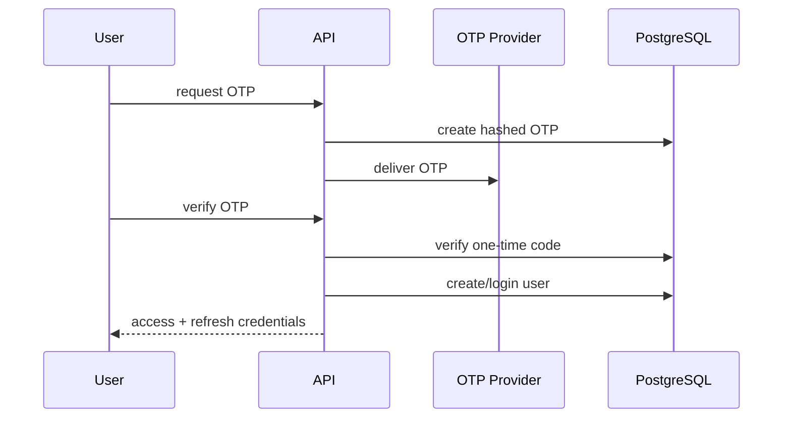
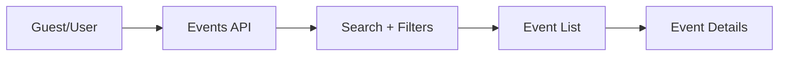
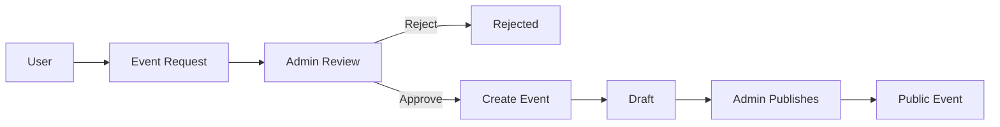
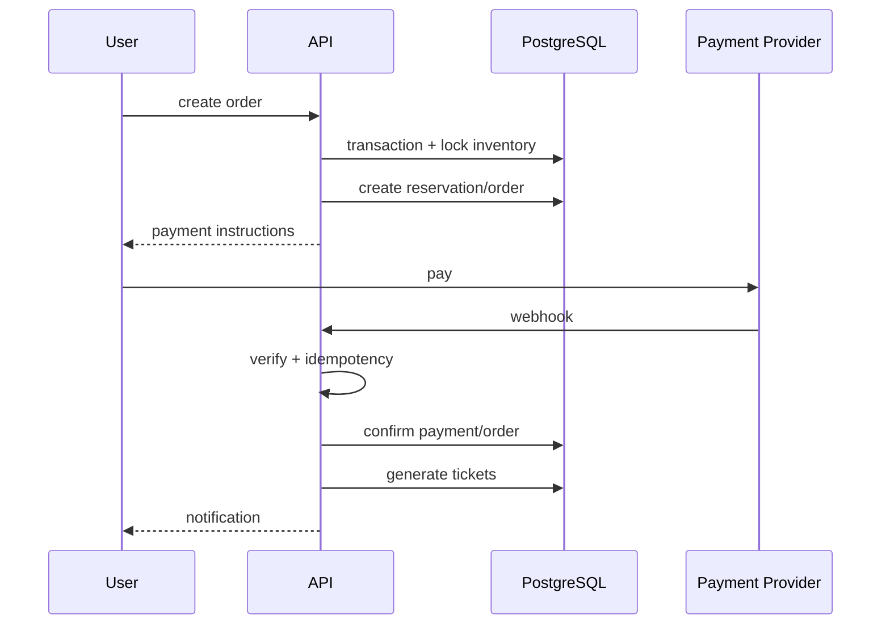

# User Flows

Each flow should be implemented as a contract between product behavior, database state, API operations, notifications, and security.

## 1. User registration/login

Failure cases: expired OTP, incorrect code, max attempts, resend cooldown, rate limit.

## 2. Browse events

Public endpoint: `GET /api/v1/events`.

## 3. Event request approval

Approval should be transactional so the request state and resulting event cannot diverge.

## 4. Ticket purchase

Failure: payment failure/timeout releases reservation.

## 5. Event cancellation
Admin cancels event → stop sales → cancel eligible reservations → identify paid orders → initiate refunds → notify users → write audit log.

## 6. Ticket check-in
Staff/Admin scans QR → validate signature/token → locate ticket → validate event → validate ticket status → reject reused/cancelled ticket → atomically mark checked in.

## 7. Admin login
Email/password → credential validation → MFA/TOTP → issue admin session/tokens → dashboard.

## Cross-flow requirements
Every flow must document:
- Purpose
- Actors
- Preconditions
- Trigger
- Happy path
- Alternatives
- Failure cases
- DB mutations
- APIs
- Notifications
- Security controls
