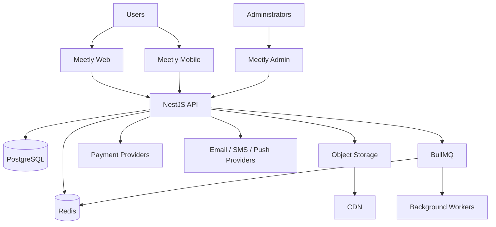

# System Architecture

## High-level architecture

## Synchronous operations
Use synchronous request/response for:
- Authentication verification.
- Event reads.
- Availability reads.
- Creating reservations/orders.
- Administrative CRUD.
- Initiating payment.

## Asynchronous operations
Use BullMQ workers for:
- OTP delivery.
- Email/SMS/push notifications.
- Reservation expiration.
- Event reminders.
- QR/ticket generation where appropriate.
- Payment webhook processing when decoupling is useful.
- Reports.

## Architectural boundary
Clients never connect directly to PostgreSQL, Redis, payment databases, or internal workers.

## Recommendation: deployment shape
Start as a modular NestJS application rather than microservices. Split services only when scale, team ownership, or operational requirements justify it.
