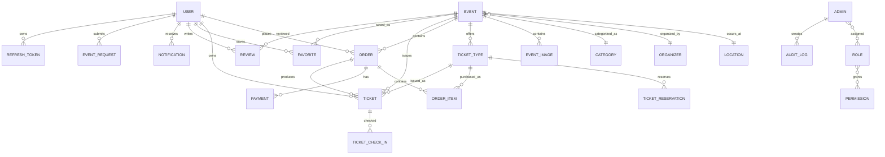

# Entity Relationship Diagram

## Cardinality notes
- A user can have many orders.
- An order can have many order items.
- An event can have many ticket types.
- A ticket type can appear in many orders.
- A user/event favorite pair is unique.
- Roles and permissions are many-to-many.
- Admins and roles are many-to-many.

Recommendation: use join tables for many-to-many relations and explicit indexes on all foreign-key columns used in filtering.
