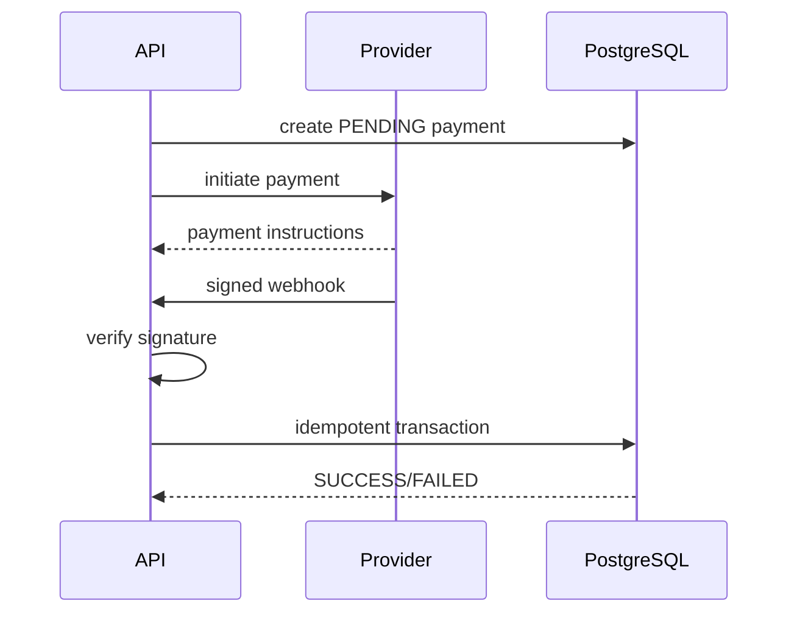

# Payments

## Provider abstraction

```text
PaymentProvider
├── createPayment()
├── verifyPayment()
├── refundPayment()
└── parseWebhook()
```

Possible providers:
- bKash
- Nagad
- Stripe

OrderService should depend on the abstraction, not a provider-specific implementation.

## Payment states
- PENDING
- PROCESSING
- SUCCESS
- FAILED
- CANCELLED
- REFUNDED
- PARTIALLY_REFUNDED

## Payment lifecycle


## Webhook requirements
1. Verify signature.
2. Identify the provider transaction.
3. Reject/reconcile duplicates safely.
4. Process inside a transaction.
5. Make retries safe.
6. Do not generate tickets twice.
7. Do not mark an order paid solely because a client says payment succeeded.

## Refunds
Refund state should be tracked independently from original payment state where necessary. Partial refunds require immutable accounting of refunded amounts.
